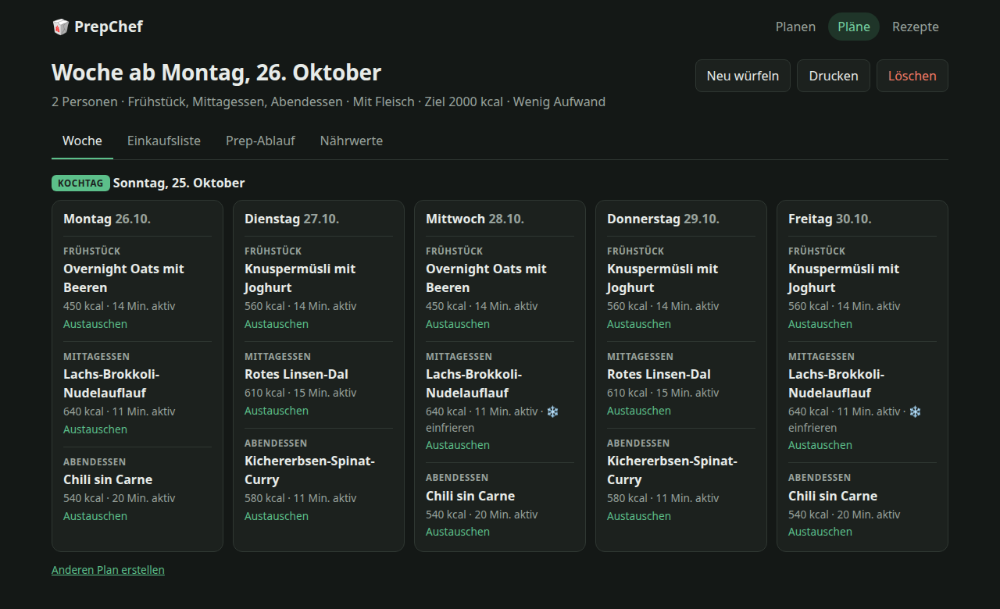
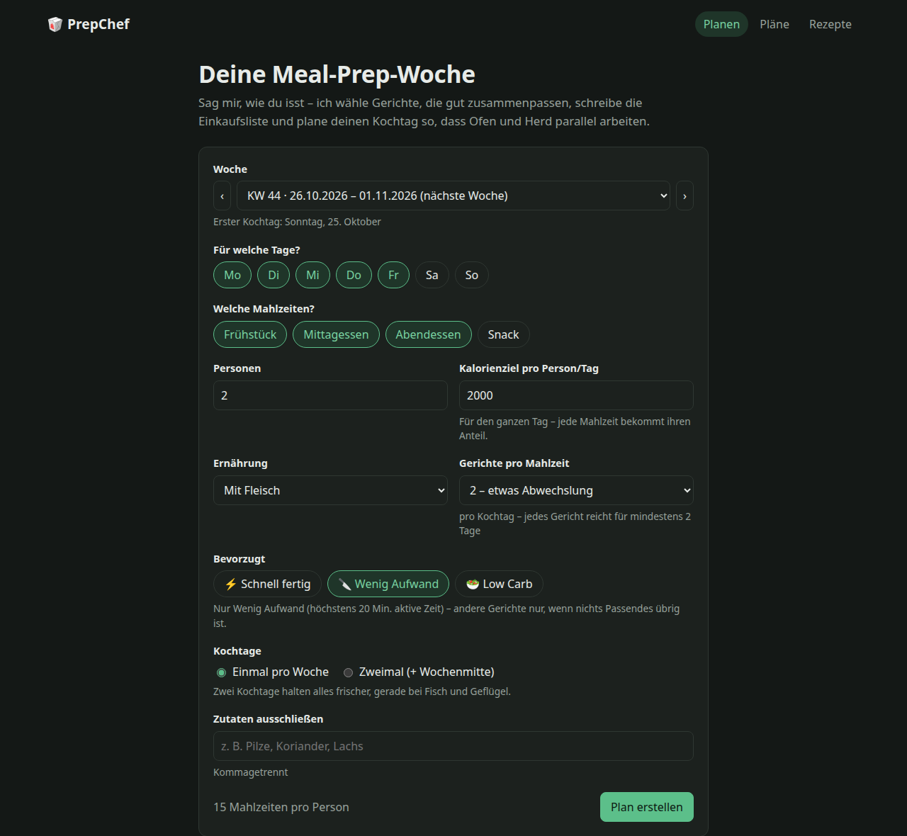
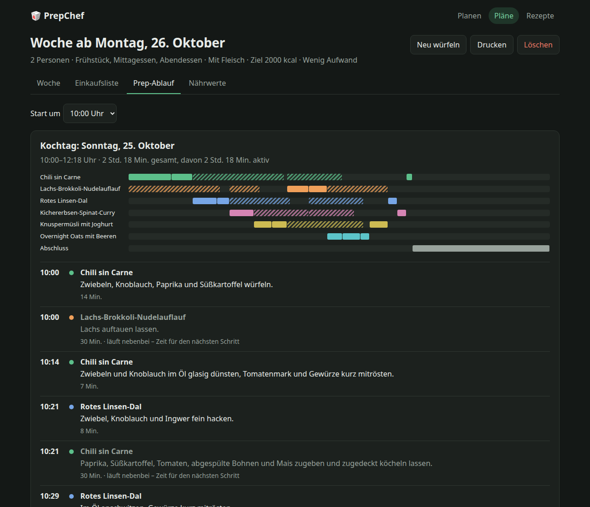
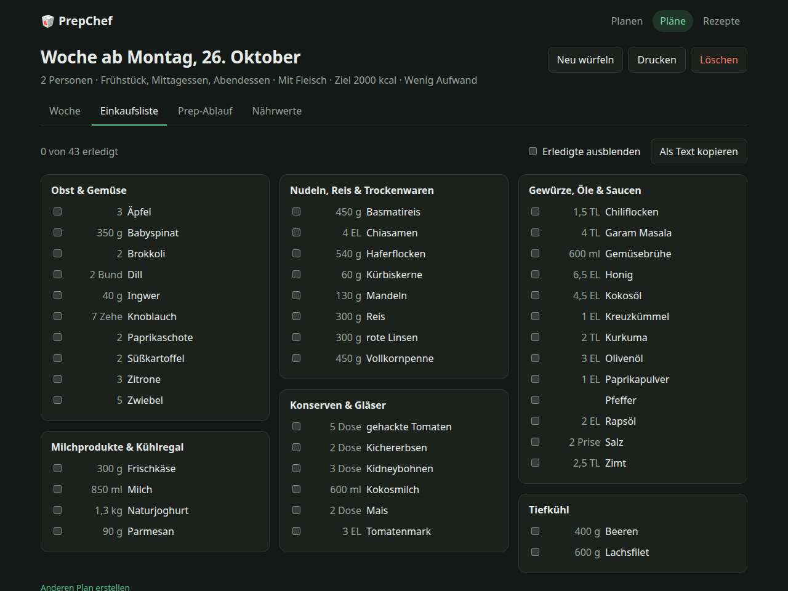
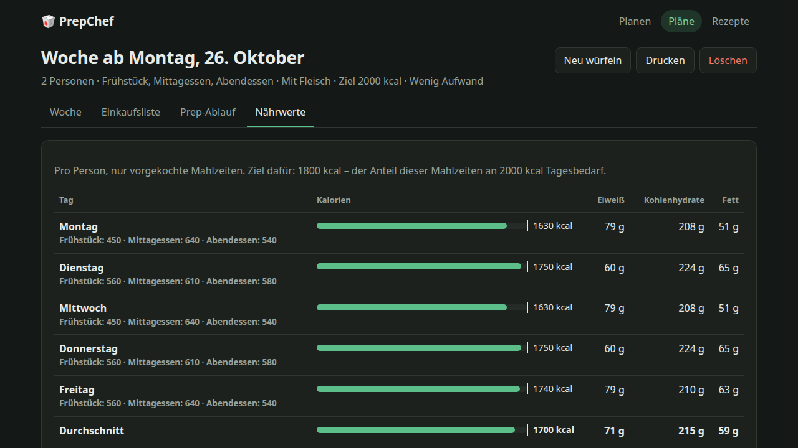
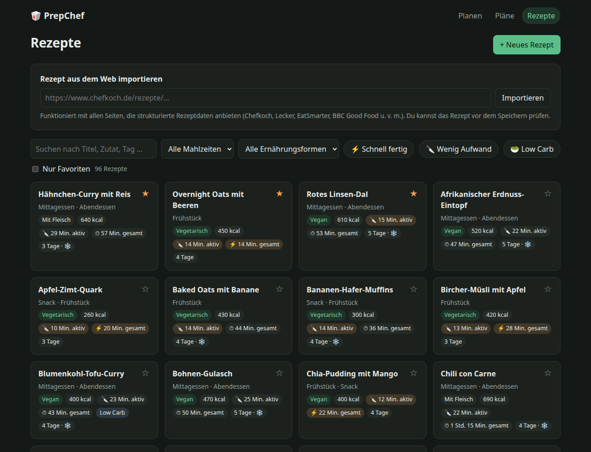
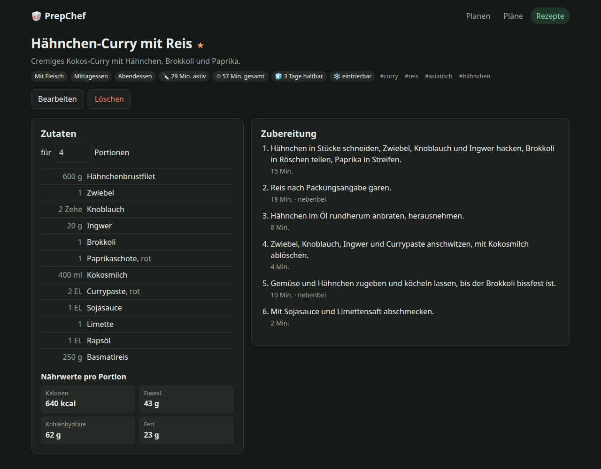
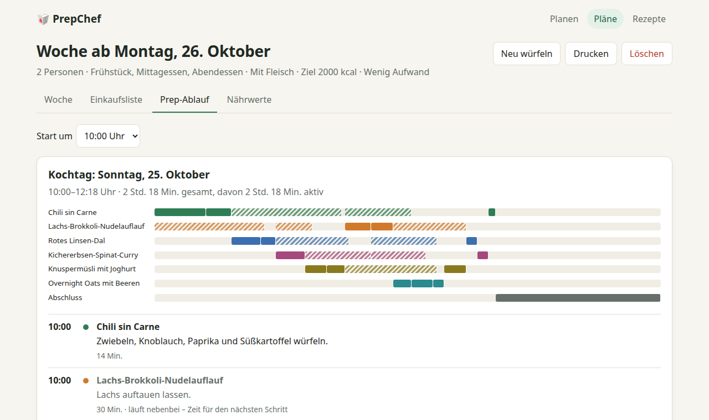
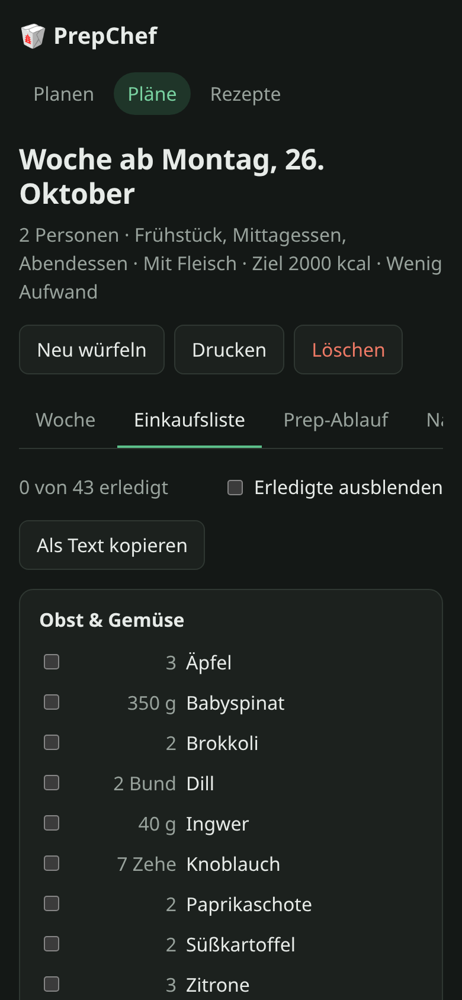

# PrepChef 🥡

Erstellt Wochenpläne fürs Meal-Prep: wählt passende Gerichte aus, erstellt eine zusammengefasste Einkaufsliste,
plant den Kochtag so, dass Ofen und Herd parallel laufen, und zeigt die Nährwerte pro Tag.



## Screenshots

| | |
|---|---|
| **Planen** – Tage, Mahlzeiten, Personen, Kalorienziel, Präferenzen | **Prep-Ablauf** – Zeitplan für den Kochtag, passive Schritte laufen nebenbei |
|  |  |
| **Einkaufsliste** – zusammengefasst, nach Supermarkt-Bereichen, abhakbar | **Nährwerte** – pro Tag und Person, verglichen mit dem Ziel |
|  |  |
| **Rezepte** – Filter, aktive und Gesamtzeit, URL-Import | **Rezept** – Zutaten auf beliebige Portionen umrechnen |
|  |  |
| **Heller Modus** – folgt der Systemeinstellung | **Mobil** – Einkaufsliste im Supermarkt |
|  |  |

Die Screenshots erzeugt `bun run screenshots` neu (Demo-Daten, Chromium wird ferngesteuert).

## Herunterladen

Fertige Dateien für Linux, Windows und macOS gibt es unter **Releases**: Datei für das eigene System herunterladen,
ausführbar machen (`chmod +x prepchef-linux-x64`) und starten – PrepChef öffnet sich in einem **eigenen Fenster**.

Das Fenster nutzt die Web-Engine des Systems: unter Windows WebView2 (bei Windows 10/11 vorinstalliert), unter macOS
WebKit, unter Linux **WebKitGTK 6.0** (`sudo apt install libwebkitgtk-6.0-4`, Fedora: `webkitgtk6.0`). Fehlt sie,
öffnet sich PrepChef stattdessen im Browser. `prepchef --browser` erzwingt den Browser, `prepchef --server` startet
nur den Server.

Die Dateien sind nicht von einer Zertifizierungsstelle signiert – Windows (SmartScreen) und macOS (Gatekeeper)
warnen daher beim ersten Start; unter macOS hilft `xattr -d com.apple.quarantine prepchef-macos-arm64`.
Prüfsummen stehen in `SHA256SUMS`.

## Als App installieren

PrepChef lässt sich zu **einer einzigen ausführbaren Datei** kompilieren – Frontend und Laufzeit sind eingebettet,
auf dem Zielrechner muss nichts installiert sein. Zum Bauen wird [Bun](https://bun.sh) gebraucht.

```bash
bun install
bun run install-app   # Linux: baut, installiert nach ~/.local/bin, legt Eintrag im Anwendungsmenü an
```

Danach startet PrepChef über das Anwendungsmenü oder mit `prepchef` in einem eigenen Fenster; Schließen des
Fensters oder „Beenden“ oben rechts beendet die App. Läuft PrepChef schon, öffnet ein zweiter Start nur ein
weiteres Fenster dazu; ist Port 3001 belegt, wird der nächste freie genommen. Beim ersten Installieren wird `data/prepchef.db` aus dem Repository übernommen
(kopiert; der Entwicklungsserver muss dafür beendet sein).

Nur die Datei bauen, ohne zu installieren:

```bash
bun run package       # → dist/prepchef
bun run package:all   # zusätzlich Linux arm64, Windows x64, macOS x64/arm64
./dist/prepchef --help
```

Die App speichert ihre Daten unter `~/.local/share/prepchef/` (Linux), `~/Library/Application Support/PrepChef/`
(macOS) bzw. `%APPDATA%\PrepChef\` (Windows); `--data <ordner>` wählt einen anderen Ort.

## Entwickeln

Voraussetzungen: **Bun** sowie **Node.js ≥ 24** für die Tests. Die Datenbank läuft unter Bun mit `bun:sqlite`,
unter Node mit `node:sqlite` (`server/src/db.ts`).

```bash
bun install
bun run dev        # Backend :3001 + Frontend :5173 → http://localhost:5173
bun run build && bun run start   # ein Prozess mit gebautem Frontend → http://127.0.0.1:3001
bun run app        # wie die fertige App im eigenen Fenster, aber aus dem Quelltext
```

| Variable       | Standard            | Zweck                    |
| -------------- | ------------------- | ------------------------ |
| `PORT`         | `3001`              | Port des Backends        |
| `HOST`         | `127.0.0.1`         | Bind-Adresse             |
| `PREPCHEF_DB`  | `data/prepchef.db`  | Pfad zur SQLite-Datei    |

Beim ersten Start wird die Datenbank mit 96 Grundrezepten befüllt. Kommen in einer neuen Version Grundrezepte
hinzu, werden sie in bestehende Datenbanken nachgeliefert – selbst gelöschte Grundrezepte bleiben gelöscht.

## Funktionen

- **Planer:** Tage, Mahlzeiten, Personen, Kalorienziel, Ernährungsform, Ausschlüsse, ein oder zwei Kochtage.
  Bevorzugt Gerichte mit gemeinsamen Zutaten, achtet auf Haltbarkeit (kurz Haltbares zuerst essen, sonst einfrieren),
  Abwechslung (Tags, zuletzt gekochte Gerichte) und Favoriten. Einzelne Gerichte lassen sich austauschen.
- **Zeiten:** Jedes Rezept hat eine *Gesamtzeit* (alle Schritte inkl. Garen, Backen, Auftauen) und eine *aktive
  Zeit* (nur Schritte, die nicht als „nebenbei“ markiert sind).
- **Präferenzen:** werden aus den Rezeptdaten abgeleitet (`server/src/domain/traits.ts`) – im Planer stark bevorzugt,
  in der Rezeptliste als Filter:
  - *Schnell fertig* – höchstens 30 Min. Gesamtzeit
  - *Wenig Aufwand* – höchstens 20 Min. aktive Zeit
  - *Low Carb* – höchstens 25 g Kohlenhydrate pro Portion
- **Einkaufsliste:** skaliert auf Personen × Mahlzeiten, rechnet Einheiten um (g/kg, ml/l, TL/EL), fasst
  Singular/Plural zusammen, sortiert nach Supermarkt-Bereichen, abhakbar, als Text kopierbar.
- **Prep-Ablauf:** Zeitplan für eine Person in der Küche – aktive Schritte nacheinander, passive (Ofen, Köcheln,
  Quellen) laufen nebenbei. Mit Gantt-Übersicht und Anzahl der Boxen.
- **Nährwerte:** pro Tag und Person; das Tagesziel wird anteilig auf die geplanten Mahlzeiten verteilt.
- **Rezepte:** anlegen, bearbeiten, favorisieren. Zutaten als Freitext („1 Dose Tomaten, gehackt (400 g)“) mit
  Live-Vorschau, wie sie verstanden werden.
- **URL-Import:** liest `schema.org/Recipe` (JSON-LD) – funktioniert u. a. mit Chefkoch, Lecker, EatSmarter,
  BBC Good Food. Der Import ist ein Entwurf, der vor dem Speichern geprüft wird (Haltbarkeit und Schrittdauern
  stehen selten auf Rezeptseiten).

## Aufbau

```
server/src/
  domain/      reine Logik: ingredients (Parser, Kategorien), units, importer,
               planner, shopping, timeline, nutrition
  repo/        SQLite-Zugriff (Rezepte, Pläne)
  seed/        Grundrezepte
  app.ts       Fastify-Routen (/api/...)
  index.ts     Start aus dem Repository (dev/start)
  standalone.ts  Start als Desktop-App (Datenordner, Port, Fenster/Browser)
  server-worker.ts  Server-Thread neben dem App-Fenster
  webview-loader.js  lädt das native Fenster (webview-bun) mit Rückfall auf den Browser
  desktop.ts   App-Fenster aus dem Quelltext starten (bun run app)
scripts/
  package.ts   baut die ausführbare Datei (bun build --compile)
  install-linux.sh
  smoke-test.ts  startet die fertige Datei als Server bzw. im Fenster und prüft sie
  screenshots.ts  erzeugt docs/screenshots/ (bun run screenshots)
client/src/
  pages/       Planen, Plan, Pläne, Rezepte, Rezept, Editor
  components/  Wochenansicht, Einkaufsliste, Prep-Ablauf, Nährwerte
```

Das Frontend nutzt die Typen und den Zutaten-Parser des Servers direkt.

```bash
bun run test       # Server-Tests (node:test)
bun run typecheck
```

## CI und Releases

`.github/workflows/ci.yml` läuft bei jedem Push und Pull Request: Typecheck, Tests, Frontend-Build, dann baut jede
Plattform (Linux, Windows, macOS) auf ihrem eigenen Runner die ausführbaren Dateien und startet sie per
`scripts/smoke-test.ts` wirklich – einmal als Server (API, Frontend, Plan, Beenden) und einmal im **App-Fenster**,
das nach dem Rendern der Oberfläche selbst meldet, ob alles geklappt hat (Linux mit virtuellem Display).

Ein Tag `v*` erstellt zusätzlich ein GitHub-Release mit den Dateien für alle Plattformen und `SHA256SUMS`;
Tags mit Bindestrich (z. B. `v1.0.0-rc.1`) werden als Vorabversion markiert. Die Version aus dem Tag zeigt
`prepchef --version`.

```bash
git tag v0.1.0
git push origin v0.1.0
```
